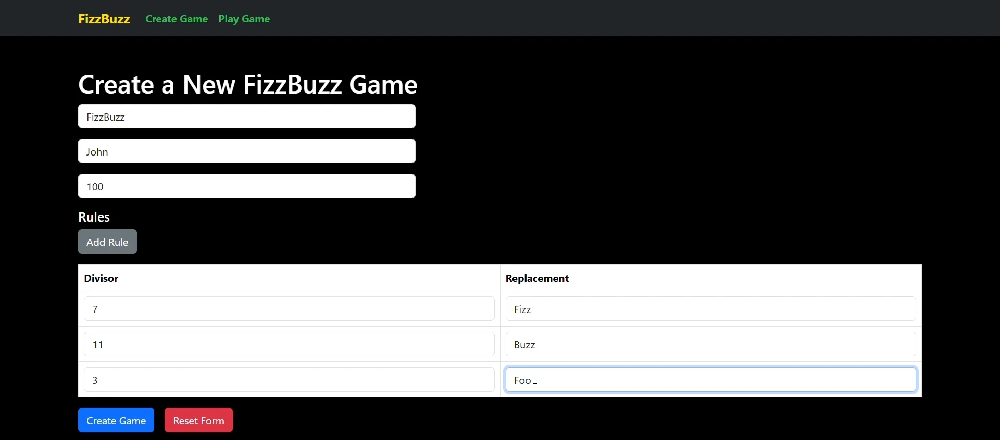

# FizzBuzz Game

A web app for making up your own FizzBuzz-style games and playing them. You choose which numbers map to which words and how high the numbers go, then answer random numbers against the clock and get a score at the end.

The backend is an ASP.NET Web API with Entity Framework and SQL Server, and the frontend is React with TypeScript, built with Vite.



[Watch the demo video](https://drive.google.com/file/d/1cM2hAX-ElEybmh4XAQlP9e35T7Jh2oc6/view) (about a minute).

## Features

- Create a game with a name, an author, a number range and any number of rules, where each rule maps a divisor to a word.
- Play a game with a time limit you set. Each round shows a random number in the range, and you type the number or the matching words.
- See your score when the time runs out.

## Tech stack

- **Frontend:** React, TypeScript, Vite, Axios, Bootstrap
- **Backend:** ASP.NET Web API (.NET 8), Entity Framework Core
- **Database:** SQL Server

## Run it locally

### Prerequisites

- .NET 8 SDK
- SQL Server
- Node.js and npm

### 1. Database

Create a database in SQL Server and run [`backend/DB_Schema_Script.sql`](backend/DB_Schema_Script.sql) against it to create the tables.

### 2. Backend

1. Copy `backend/FizzBuzzAPI/appsettings.json.example` to `backend/FizzBuzzAPI/appsettings.json` and set `DefaultConnection` to your database.
2. From `backend/FizzBuzzAPI`, run:

   ```sh
   dotnet run --launch-profile https
   ```

   The API runs at https://localhost:7037, with Swagger UI at https://localhost:7037/swagger.

### 3. Frontend

1. Copy `frontend/.env.example` to `frontend/.env` and set `VITE_API_BASE_URL` to the backend URL, for example `https://localhost:7037`.
2. From `frontend`, run:

   ```sh
   npm install
   npm run dev
   ```

   Then open http://localhost:5173.

## Known gaps

- The `docker-compose.yml` is a work in progress and isn't a supported way to run the app yet.
- There are no automated tests.
- Games can't be edited, deleted or browsed from the UI yet, and the **Play Game** link always opens the first game. To play another game, go to `/play-game/<id>` directly.
